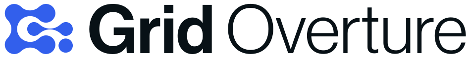

<p align="center">
  <picture>
    <source media="(prefers-color-scheme: dark)" srcset="assets/logo-horizontal-dark.svg">
    
  </picture>
</p>

<h1 align="center">Grid Overture Python SDK</h1>

<p align="center">
  <strong>Power network models from Python: import, edit, solve and read the results as DataFrames.</strong>
</p>

<p align="center">
  <a href="https://github.com/Grid-Overture/gridoverture-sdk/actions/workflows/ci.yml"></a>
  <a href="LICENSE"></a>
  
</p>

<p align="center">
  <a href="#quick-start">Quick start</a> ·
  <a href="#what-you-can-do">What you can do</a> ·
  <a href="docs/reference.md">Reference</a> ·
  <a href="#versions">Versions</a> ·
  <a href="README.es.md">En español</a>
</p>

`gridoverture` is the Python client of the Grid Overture platform, which takes power network
models from PSS/E, MATPOWER, pandapower, VeraGrid, IEEE CDF and PowerFactory to CGMES 3.0, keeps
every version of them, and runs studies on them with open engines.

It is shaped after PowerFactory's Python API: find an object, set its attributes, run a
calculation, read its results. Three things change. A calculation is an asynchronous job, settings
and attributes are typed, and results come out as tables that turn into pandas DataFrames.

## Quick start

**1. Install** it, on Python 3.11 or later. The `pandas` extra adds `to_pandas()`.

```bash
pip install "gridoverture[pandas] @ git+https://github.com/Grid-Overture/gridoverture-sdk@v0.1.0"
```

**2. Get a personal access token.** Sign in to the Grid Overture Studio, open the account menu,
**Access tokens**, and make one with the `write` scope. It starts with `gop_` and is shown once.

```bash
export GRIDOVERTURE_URL=https://<your platform's address>
export GRIDOVERTURE_TOKEN=gop_...
```

**3. Import a model, run a load flow and read the results.** The IEEE 14-bus case is in
[`examples/IEEE_14_bus.raw`](examples/IEEE_14_bus.raw).

```python
import gridoverture as go

with go.Client() as client:  # reads GRIDOVERTURE_URL and GRIDOVERTURE_TOKEN
    project = client.projects.create("IEEE 14")
    version = project.versions.import_file("IEEE_14_bus.raw").wait()

    flow = version.power_flow(go.PowerFlowSettings(start="flat")).wait(timeout=120)
    print(flow.converged, flow.summary["losses_mw"])

    buses = flow.buses.to_pandas()
    print(buses[["name", "v_pu", "angle_deg"]].sort_values("v_pu").head())
```

That is the whole loop: the file went to storage through a signed URL, an import job made a
CGMES 3.0 version of it, and a power flow job solved that version on the platform. Nothing ran on
your machine but Python.

## What you can do

Everything the platform's public API offers, as Python objects. Each row is the method and the
HTTP route under it.

| | In Python | Over HTTP |
|---|---|---|
| **Projects** | `client.projects.list()`, `.get(name)`, `.get_by_id(id)`, `.create(name)` | `GET /projects`, `GET /projects/{id}`, `POST /projects` |
| **Import a model** | `project.versions.import_file(path)`: `.raw`, `.m`, `.json`, `.veragrid`, `.cdf`, and CGMES or PowerFactory pf2xml as a zip or a folder | `POST /uploads`, `POST /uploads/{id}/complete`, `POST /projects/{id}/versions` |
| **Versions** | `project.versions.list()`, `.latest()`, `client.get_version(id)`, `version.download(path)` | `GET /projects/{id}/versions`, `GET /versions/{id}` |
| **Find objects** | `version.find("EnergyConsumer", "Load 3 1")`, `version.objects("Switch")`, subclasses included | the version's CGMES file, read on your machine |
| **Edit** | `version.edit([go.SetAttribute(...), go.AddObject(...), go.RemoveObject(...)])` makes a child version; the parent never changes | `POST /projects/{id}/versions` |
| **Power flow** | `version.power_flow(go.PowerFlowSettings(...))`: buses, branches and violations as tables | `POST /power-flows` |
| **Validate** | `version.validate()`: structure, consistency and physics findings | `POST /validations` |
| **Export** | `version.export("raw")`, `"matpower"`, `"pandapower"`, `"veragrid"`, `"cgmes"`, with a report of what was kept and lost | `POST /exports`, `GET /artifacts/{id}` |
| **Jobs** | `job.wait()`, `job.cancel()`, `client.jobs.get(id)`, `client.jobs.list()` | `GET /jobs`, `GET /jobs/{id}`, `POST /jobs/{id}/cancel` |
| **Who am I** | not wrapped yet: the user, tenant and role a token acts for | `GET /me` |

Every class, argument and exception is in [the reference](docs/reference.md).

### Edit, solve again, compare

```python
settings = go.PowerFlowSettings(reactive_limits=True)
before = version.power_flow(settings).wait()

load = version.find("EnergyConsumer", "Load 3 1")  # a ConformLoad or NonConformLoad too
edit = go.SetAttribute(load.mrid, "EnergyConsumer.p", load["EnergyConsumer.p"] + 20.0)
heavier = version.edit([edit]).wait()  # a child version; `version` does not change

after = heavier.power_flow(settings).wait()
dv_pu = after.buses.to_pandas()["v_pu"] - before.buses.to_pandas()["v_pu"]
print(dv_pu.sort_values().head())

heavier.export("cgmes").wait().download("ieee14-heavier.zip")
```

[`examples/ieee14_power_flow.py`](examples/ieee14_power_flow.py) is this study end to end, and
[`examples/ieee14_power_flow_powerfactory.py`](examples/ieee14_power_flow_powerfactory.py) is the
same study in PowerFactory's own Python API, side by side.

### When something goes wrong

Errors are exceptions you can catch by kind, and each one carries the platform's request id:

```python
try:
    version.edit([go.SetAttribute(load.mrid, "not a CIM name", 1.0)])
except go.InvalidRequestError as error:
    print(error)  # 422 the request is not valid: body.edits[0].set.attribute: ... (request 3f2a...)
```

A job that fails raises `JobFailedError` from `wait()`, with the engine's message; one that takes
longer than its `timeout` raises `JobTimeoutError` and keeps running, so you can wait again.

## Authentication and the gateway

The SDK speaks only to the platform's public gateway, the one door the platform opens to the
internet. The gateway lets through the public routes above and nothing else, and only for a
request with a personal access token, sent as `Authorization: Bearer gop_...`.

- **Scope.** A `read` token reads; a `write` token can also upload, edit and run studies. No token
  administers, and no token makes another token.
- **Lifetime.** 90 days by default, 365 at most. Revoking it in the Studio stops it at once.
- **Where it goes.** Only to the gateway. Files go to storage through signed URLs, on a separate
  HTTP client that never carries the token.
- **Tenancy.** Every request acts for the token's user, in their organization. You see your own
  projects and the ones your colleagues share; nothing of anyone else's.

`go.Client(base_url, token)` takes both explicitly; without them it reads `GRIDOVERTURE_URL` and
`GRIDOVERTURE_TOKEN`.

## Versions

The SDK and the platform are released separately, and meet at a versioned **API contract**: the
platform's public API, with a semver version of its own. The SDK follows
[semantic versioning](https://semver.org) too; before 1.0 a minor release may change its Python
API, and [the changelog](CHANGELOG.md) says how.

- **Which contract it implements.** Each release is generated from the platform's
  `openapi.public.json`, vendored in [`spec/`](spec); the spec's version is the contract, as
  `go.CONTRACT`. Every GitHub Release says it on a line of its own,
  `Gridoverture-Contract: 1.0.0`, which the platform's releases read.
- **What it checks.** Every answer of the platform names its contract in a
  `Gridoverture-Contract` header. A newer minor of the same major works: a minor only adds. Another
  major raises `IncompatibleContractError`, naming both contracts and pointing here. A route the
  platform deprecates (a `Deprecation` or `Sunset` header) becomes a `DeprecatedApiWarning` with its
  dates.
- **How it keeps up.** When the platform's public API grows, a pull request here takes the new
  spec, regenerates the client, and adds the hand-written layer for what is new.
- **How the platform keeps it honest.** The platform pins the SDK at a tag and runs it against its
  own API in its tests, so a change on either side that breaks the other is caught before release.

### Compatibility

| SDK | API contract | Works with |
|---|---|---|
| v0.2.0 | 1.x | a platform that speaks contract 1, its `/v1` routes |
| v0.1.0 | none | a platform from before the contract; later ones keep its unversioned routes as deprecated aliases until their sunset |

Pin a tag in what you install (`@v0.2.0`), not a branch.

## Contributing

Pull requests are welcome. [CONTRIBUTING.md](CONTRIBUTING.md) has the setup (`uv sync`),
the checks (`make lint test`), how the generated client is kept in step with the platform, and how a
release is cut.

## License

[AGPL-3.0-or-later](LICENSE). The CGMES 3.0 class hierarchy in
[`spec/cgmes-3.0-class-parents.json`](spec/cgmes-3.0-class-parents.json) is derived from ENTSO-E's
CGMES 3.0 vocabularies, published under Apache-2.0. The Grid Overture name and logo are trademarks
of Grid Overture and are not covered by the license.
